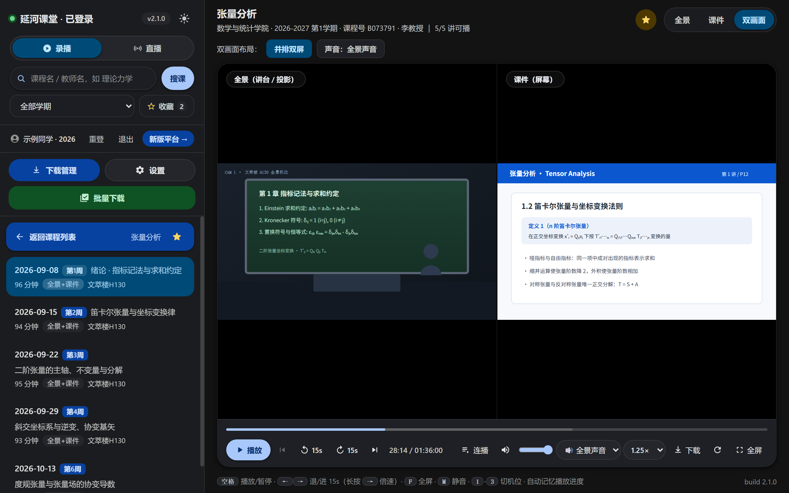
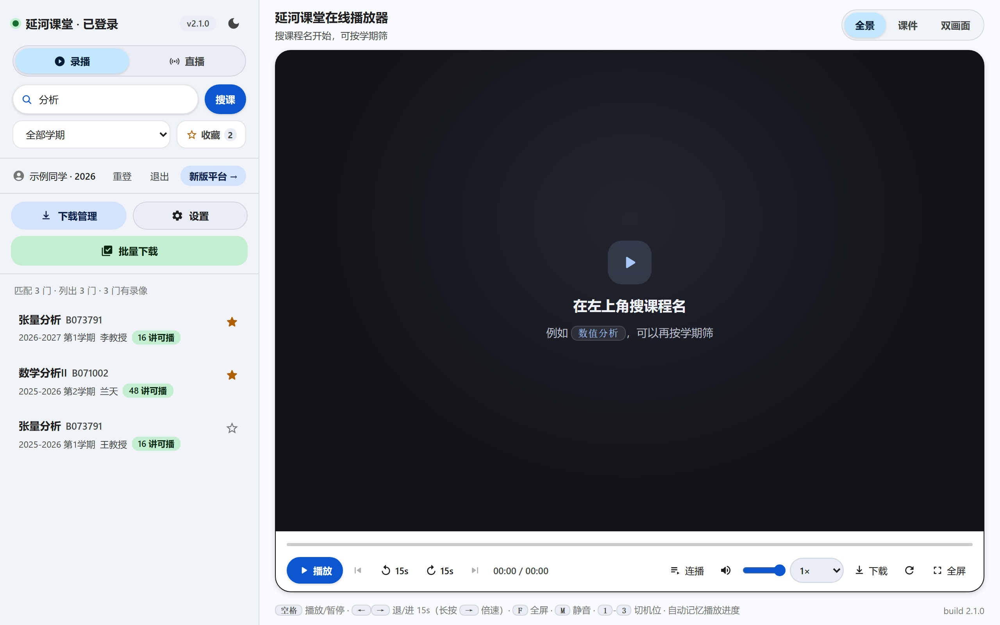
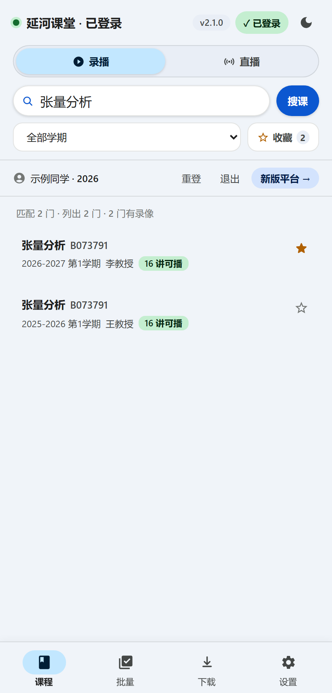
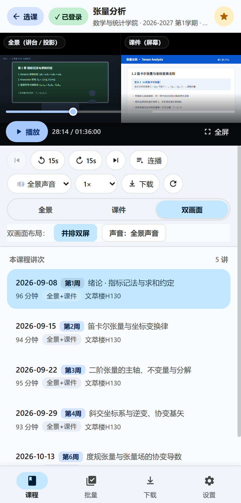

# 延河课堂 在线播放器

北京理工大学「延河课堂」课程录像的本地播放器：**电脑端提供独立桌面客户端安装包，手机端提供 Android APK**，
搜课程名就能看录播 / 直播，**往年的课（包括平台显示“课程已过期”的）、未选修 / 无权限的课，都能看**；
同时支持老平台（`www.yanhekt.cn`）与新版平台（`aita.yanhekt.cn`）。



## 功能介绍

| 功能 | 说明 |
|---|---|
| **录播多机位播放** | 支持全景（讲台 / 投影）、课件（屏幕）、双画面模式；双画面自动时间对齐，声音默认走全景并支持多音轨切换 |
| **往年与未选修课程** | 不要求课程出现在你的课表里；老平台往年课程入口关闭后自动改走讲次接口，提示「已过期」照样能看 |
| **本地课程库秒搜** | 内置老平台约 7.9 万门 + 新版约 2.7 万门课程索引，毫秒级搜课名 / 教师名 / 学期筛选，零网络延迟 |
| **跨平台课程收藏** | 老平台与新版平台收藏统一持久化保存，方便随时一键触达 |
| **断点续播与自动连播** | 自动记住每讲播放进度，支持播完自动连播下一讲（可在设置中开关） |
| **直播（免登录）** | 列出全校当前 / 即将开始的直播课，支持全景 / 课件 / 教室三路画面与双画面 |
| **单讲与批量下载** | 电脑端自动直存自定义目录，手机端存系统「下载」；支持多讲排队批量下载、取消即删与双画面双路保存 / FFmpeg 合屏导出 |
| **独立桌面窗口 & 手机手势** | 电脑端升级为 WebView2 原生桌面窗口，不再需要开着黑框命令行贴网址；手机端全面适配触控手势与底部四栏导航 |
| **只在本机运行** | 本地服务仅监听 `127.0.0.1`，不上传账号密码或个人数据 |

## 快速开始（Release 下载）

从 [Releases](https://github.com/mmck111/yanhekt-player/releases) 下载对应端安装包即可（仓库源码另附本地自编脚本）：

| 文件 | 适用平台 | 说明 |
|---|---|---|
| `yanhekt-setup-2.1.0-windows-amd64.exe` | 电脑（Windows 10 / 11，x64） | **独立桌面版安装向导**：内置 WebView2 客户端 + 本地引擎，安装时可自定义安装目录与默认下载保存目录 |
| `yanhekt.apk` | 手机（Android 6.0+，arm64） | **手机版安装包**：内置同一套 Go 引擎（`libyhkt.so`），包含手机端适配播放体验。 |

> 个人开源构建未购买商业代码签名证书：Windows 首次运行安装程序若触发 SmartScreen 提示，点 **「更多信息 → 仍要运行」** 即可；安装完成后从桌面快捷方式日常启动不会再拦截。Android 安装时允许「未知来源 / 安装未知应用」即可。

---

## 电脑端使用指南（Windows 安装版）

### 1. 安装与启动

1. 下载并运行 `yanhekt-setup-2.1.0-windows-amd64.exe`；
2. 在安装向导中按需修改**安装位置**与**默认下载保存目录**
3. 打开即是一个原生桌面窗口（支持浅色 / 深色主题）

### 2. 登录（老平台 / 新版平台）

- **窗口内一键登录**：点击登陆后，直接在应用内弹出的登录窗口登录一次校园统一身份认证（`sso.bit.edu.cn`），登录成功后自动同步会话并关闭弹窗
- **浏览器自动读取兜底**：若你此前已在本机 Edge / Chrome / Brave / Vivaldi 登录过老平台，播放器启动时也会自动尝试读取本地登录态；
- **两套系统独立**：老平台（`yanhekt.cn`）与新版平台（`aita.yanhekt.cn`）登录凭证互相独立，建议各登录一次；切换入口在顶栏「新版平台 / ← 回老平台」。

### 3. 搜课、播放与快捷键

- 顶部输入框支持按**课程名 / 教师名**（空格组合）即时检索并按学期筛选；
- 支持 **收藏课程**、历史搜索记录、断点续播、倍速记忆；
- **键盘快捷键**：
  - `空格`：播放 / 暂停
  - `←` / `→`（短按）：后退 / 快进 15 秒
  - **`→`（长按不放）**：临时 **2× 倍速快放**，松手自动恢复原倍速
  - 更多快捷键详见视频播放界面下介绍



### 4. 单讲下载、批量下载与设置

- **单讲下载**：播放栏点「下载」，按当前机位直接保存完整视频文件（老平台 `.ts`，新版平台 `.mp4`）；「双画面」模式下默认零依赖并发下载全景 + 课件双文件，若本机 `PATH` 中有 `ffmpeg` 也可一键合成为左右并排单文件 MP4；
- **批量下载**：点击「批量下载」可搜多门课或直接载入当前课程全部讲次，勾选后排队后台下载，在「下载管理」面板实时查看速度、取消或重试；
- **⚙ 设置面板**：可集中配置默认观看视角、双画默认布局（并排 / 画中画）、默认倍速、自动连播下一讲、记住上次播放位置、浅/深色主题与默认保存目录。

---

## 手机端使用指南（Android APK）

手机端与电脑端共享同一套 Go 核心引擎（交叉编译为 `android/arm64` 的 `lib/arm64-v8a/libyhkt.so`，本地监听 `127.0.0.1:8799`），搜课索引、往年课解析、双平台播放与下载能力完全一致，并针对竖屏与触控体验做了专项设计：

| 课程检索与收藏（底部四栏导航） | 并排双屏播放与同课讲次切换 |
| :---: | :---: |
|  |  |

### 1. 导航结构

- **常驻四栏底部导航**：底部固定「**课程 · 批量 · 下载 · 设置**」四个模块
- **课程与播放一体**：点击课程选定讲次后直接进入播放界面；非全屏时下滑下方列表即可点选同课程其它讲次，点击左上角返回即可退回课程列表。

### 2. 触控手势与分屏布局

- **双击画面**：播放 / 暂停
- **长按画面**：震动反馈提示并进入**临时加速**，松手立即恢复原倍速
- **左右滑动画面**：快进 / 快退
- **上下滑动画面**：**左半屏上下滑调节屏幕亮度**，**右半屏上下滑调节媒体音量**；

### 3. 手机端登录与下载管理

- **当前平台状态指示**：课程页右上角按钮实时显示**当前所在平台**的登录状态（未登录 / ✓ 已登录）
- **官网直登与自动回跳**：点击登录跳转对应官网页（老平台 `www.yanhekt.cn`、新版 `aita.yanhekt.cn/portal/`），新版页自带竖屏弹窗适配与校内统一认证（`sso.bit.edu.cn`）白屏自愈；登录完成后后台捕获 token 并自动回跳播放器，也可点击顶部返回栏「← 返回播放器」手动返回；
- **原生下载面板**：点击底部「下载」直接在应用内打开下载管理面板（底部导航栏保持可见），文件保存至系统 `内部存储/Download`（Android 10+ 走 MediaStore 无需额外权限）；支持打开系统目录、调用外部播放器播放、取消即删、以及一键「清理本 App 下载的文件」。

---

## 技术架构与目录

```
┌──────────────────────┐    127.0.0.1     ┌──────────────┐   HTTPS   ┌────────────────┐
│ 桌面 WebView2 / 手机  │ ◄──────────────► │ Go 本地引擎   │ ────────► │ 延河课堂服务器  │
│  M3 前端 + hls.js    │   /p, /lp, /api  │ (127.0.0.1)  │ ◄──────── │  cbiz / aita   │
└──────────────────────┘                  └──────────────┘           └────────────────┘
```

- **后端**：Go 单引擎（`CGO_ENABLED=0`），通过 `go:embed` 将 `public/` 前端页面、设置/批量脚本与双平台离线课程库打包进二进制；
- **桌面壳**：Windows 原生 Win32 + WebView2 COM 嵌入窗口（`go/app_windows.go`、`go/webview2_com_windows.go`），外加 Go 自解压安装向导（`go/cmd/setup/`）；
- **手机壳**：原生 `Activity` + `WebView` + `@JavascriptInterface` 桥接（振动反馈、窗口亮度、媒体音量、原生并发下载器与 MediaStore 管理）；
- **签名与课程库**：动态从官网脚本提取接口签名（`goja`）以适应平台改动；内置 `public/catalog.json.gz`（592 KB，7.9 万门）与 `public/y2-catalog.json.gz`（617 KB，2.7 万门）。

```
yanhekt-player/
├─ go/                    Go 后端与 Windows 桌面 / 安装向导源码
│  ├─ main.go             服务启动、路由注册、静态资源嵌入（当前版本 2.1.0）
│  ├─ app_windows.go      Windows 原生 WebView2 桌面窗口与 Cookie/下载桥接
│  ├─ webview2_com_windows.go  WebView2 COM 绑定
│  ├─ cmd/setup/          Windows 安装向导源码（自定义安装路径 / 下载目录 / 快捷方式）
│  ├─ api.go / search.go  老平台接口、本地检索与浏览器 profile 凭证读取
│  ├─ course.go / old_archive.go  课程详情与往年课程讲次接口兜底
│  ├─ proxy.go / download.go / dltrack.go / dual_dl.go  流代理、单讲/双路/合屏下载与队列追踪
│  ├─ live.go             直播列表与 /lp 实时代理
│  ├─ signer.go           运行时从官网提取动态签名（goja）
│  ├─ settings.go / favorites.go  设置与跨平台收藏持久化
│  ├─ y2*.go              新版平台（aita.yanhekt.cn）适配与本地检索
│  └─ build.ps1           Windows 构建脚本（同步资源 → 编译 exe 与 setup 安装包）
├─ public/                前端页面与脚本（index.html / y2.html / settings.js / batch.js / 课程库）
├─ android/               Android 工程（清单 / MainActivity.java / res 主题与启动资源 / build.ps1）
├─ installer/             Inno Setup 脚本与本地安装辅助脚本
├─ test/                  页面 ID、标签配对与书签脚本静态检查
└─ tools/                 Release 发布脚本、课程库更新与内联脚本检查
```

---

## 本地构建与验证

```powershell
# 1. 构建 Windows 端（需 Go 1.21+）
#    产出：dist\yanhekt.exe、dist\yanhekt-browser.exe、dist\yanhekt-setup-2.1.0-windows-amd64.exe
powershell -ExecutionPolicy Bypass -File go\build.ps1

# 2. 构建手机端 APK（无需 Gradle，需 JDK 17 + Android SDK 34 build-tools）
#    产出：android\build\yanhekt.apk 及 dist\yanhekt.apk
powershell -ExecutionPolicy Bypass -File android\build.ps1

# 3. 运行 Go 与前端静态检查
cd go; go vet ./...; go test -count=1 ./...
node tools\check-inline.js public\index.html public\y2.html
node test\checkids.js; node test\checktags.js public\index.html; node test\checkbookmark.js
```

## 开源与免责声明

- 本工具仅在本地 `127.0.0.1` 运行，不设远程服务器、不收集账号密码，登录凭证仅保存在本机浏览器 / WebView 会话与本地配置中。
- 课程视频版权归学校与授课教师所有，下载内容仅限个人学习使用，请勿二次传播或上传至公开平台。
- **非官方工具**：与北京理工大学及延河课堂官方无任何关联；应用图标使用延河课堂官方标志仅作识别用途。
