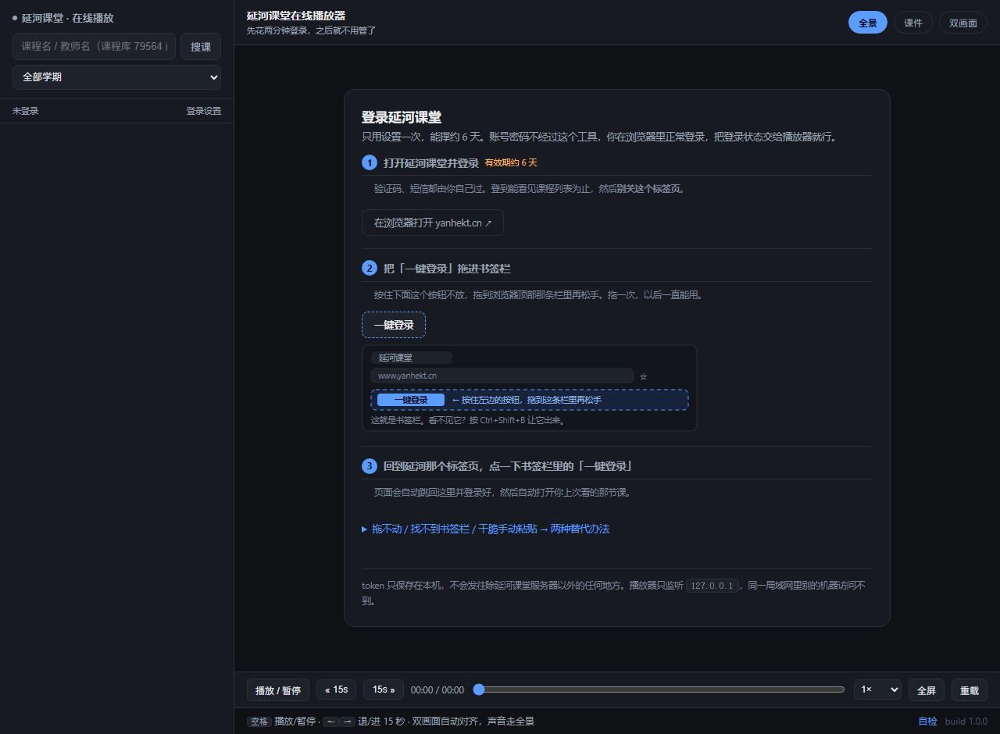

# 延河课堂 在线播放器

北京理工大学「延河课堂」课程录像的本地播放器：**双击一个 exe，复制地址到浏览器，搜课程名就能看录播**。

不用装 Node、不用命令行、不把账号密码交给程序。



---


## 快速开始

### 1. 拿到程序

到 [Releases](../../releases/latest) 下载这两个文件：

| 文件 | 说明 |
|---|---|
| `yanhekt-player.exe` | 主程序，约 90 MB，单文件，不用安装 |
| `unblock.bat` | 解除「未知发布者」提示用（只跑一次），可选但强烈建议 |

> 下载后建议先运行 `unblock.bat`（或者右键 exe → 属性 → 勾「解除锁定」）。这个程序没有代码签名证书，
> 不解除的话 Windows 每次启动都会问你一次。
> 仓库里的 `dist/解除阻止.bat` 是同一个脚本，只是文件名不同。

### 2. 双击运行

会弹出一个命令行窗口，里面写着地址：

```
═══════════════════════════════════════════════════
  延河课堂 · 在线播放器          版本 1.4.1
═══════════════════════════════════════════════════

  请复制以下链接到浏览器打开：

      http://127.0.0.1:8788/

  请勿关闭此窗口，此窗口为服务器。
  关闭窗口 ＝ 关闭播放器。
═══════════════════════════════════════════════════
```

**把这个地址复制到浏览器**，然后别关那个窗口 —— 它就是播放器本体。

> 程序**不会自己去开浏览器**：你的浏览器可能开着、可能以管理员权限开着，程序去插一脚只会弹
> 「Edge 未响应 / 是否重启实例」这种提示。所以它只管起服务、打印地址，浏览器你自己开。

### 3. 登录一次（约 6 天有效）

不需要把账号密码告诉这个程序。你在浏览器里正常登录学校系统，然后把登录状态"交"给播放器：

1. 点面板里的「在浏览器打开 yanhekt.cn ↗」，用统一身份登录，**登到能看见课程列表为止**
2. 回到面板，把 **「一键登录」** 拖进浏览器的书签栏
   - 看不到书签栏？按 `Ctrl`+`Shift`+`B`
   - 拖不动？展开「拖不动 / 手动粘贴」，有两种替代办法
3. 回到延河那个标签页，**点一下书签栏里的「一键登录」** → 自动跳回播放器，登录完成

### 4. 搜课、看课

左上角输入课程名（几个字就行，比如 `数值分析`）回车；可以用下方的**学期**下拉筛；
点课程 → 点任意讲次开始播放。

搜索结果的处理方式：

- **搜到的课全部列出来**（单次最多 120 门），不藏、不分页
- **按录像讲次数从多到少排序**：有 48 讲的排最前面，只有 1 讲的排后面
- 没有录像的课跳过不显示，列表顶部会写「跳过 N 门没录像的」
- 一门课都没有时才显示空列表，不会给你半截结果


> 截图里的课程名和老师是示例数据，界面是真的。

## 播放器功能

- 三种画面：全景（讲台/投影）、课件（屏幕）、双画面（自动对齐，声音走全景）
- 拖动进度条秒定位、倍速、全屏
- 快捷键：`空格` 播放/暂停，`←` `→` 后退/前进 15 秒
- **下载**：控制栏的「下载」按钮，把当前这一讲拼成**单个文件**存到本地
- 右下角 `自检`：把当前这门课的真实情况（节次数、可播数、取流错误）打成 JSON，排查用

### 下载录像

课程录像是 HLS（一节课被切成几百个分片），网页里没法右键另存。点控制栏的 **「下载」**：

- 下载**你当前看的那一路画面**：看「全景」就下全景，切到「课件」就下课件
- 文件是一个整体，不是几百个小碎片；命名形如 `数值分析_2026-09-08_全景.ts`
- 下载期间别关掉播放器页面（本地服务在拼分片）
- 命令行窗口里会打印进度：`下载开始：… 共 720 片，约 118 分钟`，结束打 `成功 720 片，失败 0 片`

**格式是 `.ts`**，用 **VLC / PotPlayer** 双击就能播（Windows 自带的「电影和电视」可能不认）。
想转成 mp4，自己装了 ffmpeg 的话一条命令：

```bash
ffmpeg -i 数值分析_2026-09-08_全景.ts -c copy 数值分析.mp4
```

两个实现细节，遇到问题先看这里：

- **分片失败会重试、跳过，不会一整段停掉**。以前是"某一片失败就 break"，结果两小时的课只能下出前 30 分钟——这是 bug，已修。
- 每 10 片会停 200ms，故意放慢一点，避免被学校 CDN 当成刷接口（403/429 会自动退避重试）。
- 如果下载出来还是偏短，把命令行窗口里那行 `共 N 片，约 M 分钟` 发出来：**M 明显小于课程时长**说明 CDN 只提供了一段播放列表（不是下载写错），**M 正常但成功片数少**才是网络问题。

> 下载功能只是在**你自己账号本来就能看**的前提下，把同一份流保存到本地，方便离线看。
> 别传给别人，也别传到公开网站上。

## 新版平台（另一个入口，可选）

侧栏有一个蓝色的 **「新版平台 →」**，点进去是另一个页面（`/y2`），接的是新版平台
（`aita.yanhekt.cn`）。它是**另一套系统、另一个登录**，跟主页面互不影响。

什么时候值得点进去：

- **新版覆盖的学期（最近几个学期）里，那边播放快 3~5 倍**（13~24 MB/s vs 4.5 MB/s，拖动 0.4s vs 1.1s）
- **有的课只在那边有录像**，主页面显示"无录像"时可以在那边碰碰运气
- 那边搜不到的更早学期（2022-2023 之类）是正常的，点「← 回老平台」即可

用法：

1. 点「新版平台 →」，第一次会让你登录新版：点「在浏览器打开 aita.yanhekt.cn」→ 正常登录 →
   把「一键登录」拖进书签栏 → 回到那个标签页点一下书签（和老平台那套一模一样）
2. 搜课程名 → 点课程 → 点讲次播放
3. **同样能下载**：控制栏「下载」，那边本来就是 MP4，直接存成 `.mp4`（不用转码）

两个平台是**两套独立系统**（课程 ID 都不一样：老平台 `73791`，新版 `96123`），所以：
**要各登一次，课程也要各搜一次**。程序不会自动帮你在两个平台之间对应同一门课——之前试过，
按名字猜对应关系经常猜错，反而更乱。

## 常见问题

**命令行窗口是什么？能关掉吗？**
那是本地服务本体，不能关（关掉播放器就停了）。它平时不用管，窗口里就几行提示加一个地址。

**能看多少学期的课？**
内置课程库覆盖 2004 年至今 38 个学期；但**能不能看录像取决于平台上有没有录像**，一般近几年才有。

## 技术说明

```
┌────────────┐     127.0.0.1      ┌──────────────┐   HTTPS   ┌────────────────┐
│  浏览器     │ ─────────────────► │ 本程序(本地)  │ ────────► │ 延河课堂服务器  │
│  HLS 播放   │ ◄── /p?u=<b64> ── │ Node 代理     │ ◄──────── │  cbiz / cvideo │
└────────────┘                    └──────────────┘           └────────────────┘
```

- **后端**：单文件 Node 服务（无框架）。`server.js` 约 1000 行。
- **鉴权**：token 存在浏览器 HttpOnly cookie 里，服务端只管转发，不落盘、不打日志。
- **签名**：延河课堂的视频接口要一个动态签名，`signer.js` 在运行时从官网 bundle 里现扒算法（官网改版可自愈）。
- **视频代理**：`/p?u=<base64url>` 把上游 m3u8 / 分片转成本地地址，顺便统一串行、缓存分片 ——
  学校 CDN 对并发很敏感，并发高了会挂起，所以上游是单连接串行的。
- **课程库**：`public/catalog.json.gz`（578 KB，来自学校公开的课程信息表），本地搜索不发请求。
- **打包**：Node 官方 SEA（Single Executable Applications）。`build.js` 把 `signer.js` 内联进
  `server.js`，再用 `node --experimental-sea-config` + `postject` 注入到 `node.exe` 里，
  页面和课程库作为 assets 一起塞进去，得到一个 90 MB 的单文件程序。

### 接口（都用不到登录态也能看的）

| 路径 | 作用 |
|---|---|
| `GET /` | 播放器页面 |
| `GET /api/status` | 登录状态 + 版本号 |
| `GET /api/db/terms` | 学期列表（实时 + 内置课程库合并） |
| `GET /api/db/search?q=&term=&probe=1` | 搜课；`probe=1` 顺带探"有没有录像、教室在哪" |
| `GET /api/open?id=` | 某门课的讲次和播放地址 |
| `GET /api/selftest` | 自检（学期解析、教室编码等关键判断） |
| `GET /p?u=` | 视频代理 |
| `GET /dl?course=&session=&kind=` | 下载：把这一讲的 HLS 分片拼成单文件 |

## 目录

```
yanhekt-player/
├─ server.js              后端（本地 HTTP 服务 + 代理）
├─ signer.js              老平台视频接口签名（运行时从官网现扒）
├─ yanhe2.js              新版平台（aita）接口封装
├─ build.js               打包成单文件 exe
├─ public/
│  ├─ index.html          主页面（老平台，单文件无构建）
│  ├─ y2.html             新版平台页面
│  ├─ hls.min.js          hls.js
│  └─ catalog.json.gz     内置课程库（79,564 门）
├─ tools/
│  ├─ build-catalog.py    从课程信息 xlsx 生成 catalog.json.gz
│  └─ make-shots.js       生成 README 用的界面截图（假数据 + 真界面）
├─ test/
│  ├─ smoke.js            端到端冒烟测试（起服务 + 打接口）
│  ├─ checkids.js         页面 $("#id") 引用是否都存在
│  ├─ checkhtml.js        内联脚本语法检查
│  └─ checktags.js        HTML 标签配对检查
├─ docs/                  README 截图
└─ dist/                  构建产物（exe，不入库）
```

## 开发

```bash
npm install          # 只装打包要用的 postject

node server.js       # 直接跑，浏览器开 http://127.0.0.1:8788
npm test             # 冒烟测试（会联网查一次 数值分析）
npm run check        # 静态检查：id 引用 / 脚本语法 / 标签配对
```

打包成 exe（Windows）：

```bash
node build.js
node --experimental-sea-config dist/sea-config.json
copy "C:\Path\To\node.exe" dist\延河课堂播放器.exe
npx postject dist\延河课堂播放器.exe NODE_SEA_BLOB dist/sea-prep.blob ^
  --sentinel-fuse NODE_SEA_FUSE_fce680ab2cc467b6e072b8b5df1996b2
```

## 说明

- 只监听 `127.0.0.1`，只有你自己这台机器能访问。
- 课程内容版权归学校与授课教师所有。
- 登录状态存在你自己的浏览器 cookie 里，程序不保存密码、不上传任何数据。
