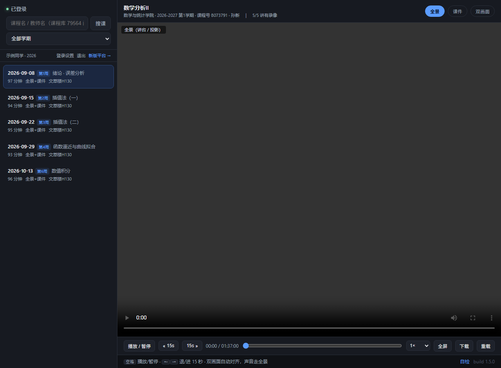
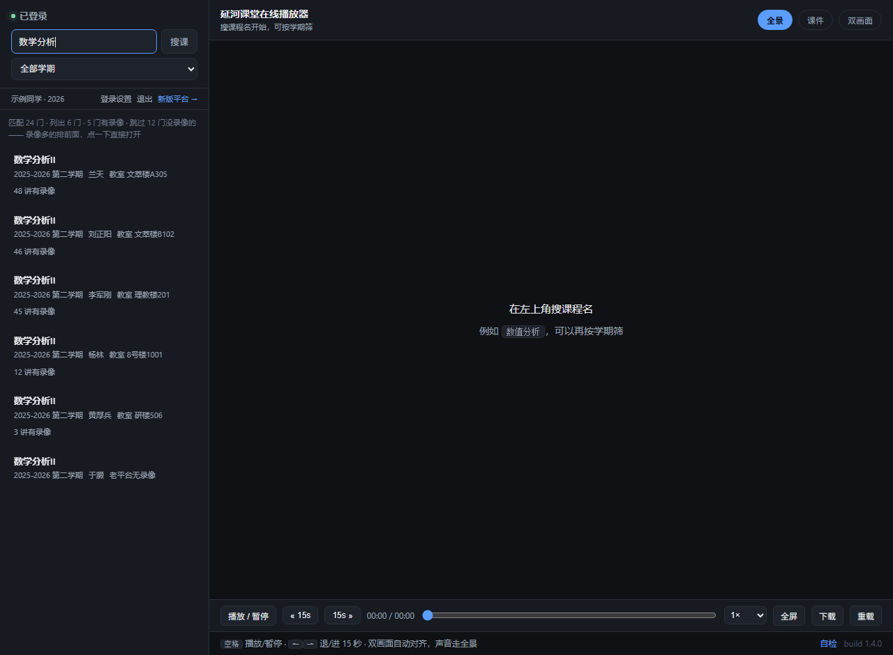

# 延河课堂 在线播放器

北京理工大学「延河课堂」课程录像的本地播放器：**双击一个 exe，把地址粘到浏览器，搜课程名就能看录播**。



## 支持的功能

| 功能 | 说明 |
|---|---|
| **录播播放** | 全景（讲台 / 投影）、课件（屏幕）、双画面三种机位；双画面自动对齐、声音走全景；拖动秒定位、倍速、音量、全屏 |
| **无权限课程也能看** | 不要求课程出现在你的课表里 |
| **往年课程** | 往届的课也能按课程名 / 教师名找到 |
| **搜索** | 课程名、教师名、学期筛 |
| **直播** | 列出全校正在播 / 即将开始的直播课，三路画面（全景 / 课件 / 教室），每分钟自动刷新 |
| **新版平台** | 另一个入口 `/y2`，接 `aita.yanhekt.cn`：同一讲三路画面、播放快 3~5 倍、MP4 / HLS 都能下 |
| **自动登录** | 从本机浏览器（Edge / Chrome / Brave / Vivaldi）已存的登录态里取凭证；读不到才需要手动点一次书签 |
| **离线课程库** | 79564 门课的名称 / 教师 / 学期 / 教室都在本地，不联网也能先搜出结果 |
| **手机查代号** | 独立的一个网页（`dist/codes.html`，0.8 MB 单文件）：手机上本地搜课程代号，点开就是 `yanhekt.cn/course/<代号>`。不需要电脑、不需要装 exe、不需要服务器；往年课只要代号就能看。<br>生成：`node tools/make-codes.js`；给同学用就把这个文件丢到任意静态站点 |
| **自检** | 页面右下角「自检」和 `/diag`：把一门课的接口原始返回、每讲状态、取流结果打出来，出问题直接看 |
| **只在本机** | 服务只监听 `127.0.0.1`，不对外、不上传任何数据；账号密码不经过程序 |

## 手机版（APK）

`dist/yanhekt.apk`（5.6 MB，Android 6.0+，arm64）—— 和电脑版**同一个引擎**：Go 后端交叉编译成
`android/arm64`、以 `lib/arm64-v8a/libyhkt.so` 打进 APK，启动时拉起来监听 `127.0.0.1:8799`，
WebView 打开它。所以功能、界面、课程库、无权限课都和 exe 一致。

和电脑版唯一的差别是登录：打开 App 直接进播放器，**不先跳登录页**。**顶栏左侧一直亮着一个登录按钮**
（未登录时写「登录」，登上一半写「✓ 新版」或「✓ 老平台」，都登好写「✓ 已登录」），点它弹出两个平台的
登录入口 —— 跳到对应官网，登好自动取 `_token` / `yht` 交给本地引擎，并把引擎下发的会话 cookie 抄回
WebView（不这么做页面会一直认为未登录），然后自己跳回播放器。

构建：

```powershell
# 工具链（只需一次）：JDK 17 + android.jar + build-tools 34，约 500 MB
#   解压到 ..\_android\jdk 和 ..\_android\sdk，或用 JAVA_HOME / ANDROID_SDK_ROOT 指定
powershell -ExecutionPolicy Bypass -File android\build.ps1   # 产出 android\build\yanhekt.apk
```

已知限制：只有 arm64（绝大多数手机）；登录态约 24 小时，过期后底部会出现「点这里重新登录」。

下载：页面里的「下载」走原生通道 —— JS 桥接把 `/y2dl` `/dl` 的 `window.open` 拦下来，
带上本地会话 cookie 直接拉流，按引擎给的 `Content-Disposition` 命名，存进系统「下载」目录
（Android 10+ 走 MediaStore，无需权限；9 及以下会要一次存储权限）。下载在 App 进程里跑，
期间最好别让系统回收 App；不支持断点续传。

删除也不用去找文件管理器，汉堡栏「⤓ 下载管理」里就能干净删掉：

- **取消**未下完的 → 半截文件当场删掉，列表里那条也一起消失；
- 已下完的那条有 **「删除」**（删文件 + 删列表项）和 **「打开」**（跳系统下载目录）；
- 面板上方 **「清理本 App 下载的文件（N 个）」** 一键清空 —— 包括以前版本没下完留下的残片；
- App 每次启动还会扫一遍自己遗留的 pending 半截行（被系统杀掉时会产生），直接清掉。


## 快速开始

### 1. 下载并运行

到 [Releases](https://github.com/mmck111/yanhekt-player/releases) 下载 `yanhekt.exe` 双击。

会弹出一个命令行窗口，地址已自动复制到剪贴板：

```
  延河课堂 · 在线播放器          版本 1.5.0
  地址已经复制到剪贴板：
      http://127.0.0.1:8788/
  请勿关闭此窗口，此窗口为服务器。
```

**把地址粘到浏览器**，然后别关那个窗口 —— 它就是播放器本体。

> 程序不会自己去开浏览器（你的浏览器可能以管理员权限开着，程序去插一脚只会弹
> 「Edge 未响应 / 是否重启实例」），所以它只管起服务、打印地址。

exe 没有代码签名证书，Windows 第一次会拦一下：右键 exe → 属性 → 勾「解除锁定」，或启动时点「更多信息 → 仍要运行」。

### 2. 登录（一般点一下就好）

打开播放器会**自己先试着登录**：去本机浏览器的本地存储里找你已有的延河登录态。
找到了直接进去，不碰账号密码、不用复制任何东西。

真没找到（第一次用，或者只在手机 / 别的浏览器登过）才需要手动来一次，约 30 秒：

1. 点面板里的「在浏览器打开 yanhekt.cn ↗」，用统一身份登录，**登到能看见课程列表为止**
2. 回来把 **「一键登录」** 拖进浏览器书签栏（看不到书签栏按 `Ctrl`+`Shift`+`B`；拖不动就展开「手动登录」直接粘 token）
3. 回到延河那个标签页，**点一下书签栏里的「一键登录」** → 自动跳回播放器并登录好

老平台登录态约 6 天，过期后重新登一次浏览器、回来点「自动登录」即可。

### 3. 搜课、看课

顶部输入课程名或教师名（几个字就行，比如 `数值分析`、`孙新`）回车；可以用学期下拉筛。

- 搜到的课单次最多列 120 门，不藏、不分页
- 匹配度相同的按录像数从多到少排
- 没有录像的课默认跳过，列表顶部会写「跳过 N 门没录像的」
- 点课程 → 点右侧任意讲次开始播放



## 播放器功能

- 右上角 **录播 / 直播** 切换：默认「录播」
- 三种画面：**全景**（讲台/投影）、**课件**（屏幕）、**双画面**（自动对齐，声音走全景）；直播多一个「教室」画面
- 拖动进度条秒定位、倍速（0.75×–2×）、音量、全屏
- 快捷键：`空格` 播放/暂停，`←` `→` 后退/前进 15 秒
- **下载**：控制栏「下载」，把当前这一讲拼成单个文件（直播不能下载）
- 右下角 **自检**：把当前这门课的真实情况（节次数、可播数、取流错误）打成 JSON

### 下载录像

录像在平台上是 HLS（一节课被切成几百个分片），网页里没法右键另存。点「下载」：

- 下载**你当前看的那一路画面**：看「全景」就下全景，切到「课件」就下课件
- 一个整体文件，不是几百个碎片；命名形如 `数值分析_2026-09-08_全景.ts`
- 下载期间别关播放器页面（本地服务在拼分片）
- 命令行窗口会打印进度：`下载开始：… 共 720 片，约 118 分钟`，结束打 `成功 720 片，失败 0 片`

格式是 `.ts`，用 **VLC / PotPlayer** 双击就能播（Windows 自带「电影和电视」可能不认）。
想转 mp4，装了 ffmpeg 的话：

```bash
ffmpeg -i 数值分析_2026-09-08_全景.ts -c copy 数值分析.mp4
```

### 直播（不用登录）

切到「直播」后，列出全校当前 / 即将开始的直播课（标题、老师、教室、时段、直播中标记），点一场就看，列表每分钟刷新。

- 直播流是 `clive*.yanhekt.cn` 上的公开 HLS，**不需要登录、也不需要选课**
- 三路画面：全景（讲台）、课件、教室；「双画面」用全景 + 课件
- 走本地 `/lp` 代理，不缓存、不排队，不挑浏览器、不会被 CORS 挡
- 下课后这场从列表消失；想留着看得等平台生成回放

## 新版平台（`/y2`，可选）

顶栏的 **「新版平台 ↗」** 是另一个页面，接的是 `aita.yanhekt.cn`，**另一套系统、另一个登录**，跟主页面互不影响。

什么时候值得点进去：

- 新版覆盖的学期里，那边**播放快 3~5 倍**（13~24 MB/s vs 4.5 MB/s，拖动 0.4s vs 1.1s）
- **有的课只在那边有录像**，主页面显示"无录像"时可以去碰碰运气
- 那边搜不到的更早学期（2022-2023 之类）是正常的，点「← 回老平台」即可

用法：点「新版平台 ↗」→ 按面板三步走（打开新版延河登录 → 把「新版一键登录」拖进书签栏 → 在延河页面点一下这个书签）→ 搜课程 → 点讲次播放。同样能下载，那边本来就是 MP4，直接存 `.mp4`。

> 书签**必须在延河课堂的页面上点**：在播放器页面点会提示你去延河页面点；在延河点但没登录，会提示你先登录。
> 新版的登录态是加密 cookie（Chromium App-Bound，只有浏览器进程能解），所以只能由你在浏览器里点一下交给播放器。

两个平台是**两套独立系统**（课程 ID 都不一样），所以要各登一次、课程各搜一次。

## 常见问题

**命令行窗口是什么？能关掉吗？**
那是本地服务本体，不能关（关掉播放器就停了）。关掉窗口 = 关掉播放器。

**能看多少学期的课？**
课程库覆盖 2004 年至今 38 个学期；**能不能看录像取决于平台上有没有录像**，一般近几年才有。

**没选过的课、往年的课真能看？**
能搜到、能点开播放，不要求你先选这门课。最终能不能播还是看平台有没有给这门课存录像。

**「自动登录」读了什么？**
只在本机读浏览器 profile 里延河课堂站点的本地存储（已存的登录凭证），拿去 `/v1/user` 验一下有效才用。
找不到就退回手动登录。不读密码、不读别的网站、不上传、不写日志。

**下载出来比课程时长短？**
命令行里那行 `共 N 片，约 M 分钟`：M 明显小于课程时长 = CDN 只给了部分播放列表；M 正常但成功片数少 = 网络问题。
中间分片失败会自动重试并跳过，不会整段停掉。

## 技术说明

```
┌────────────┐     127.0.0.1      ┌──────────────┐   HTTPS   ┌────────────────┐
│  浏览器     │ ─────────────────► │ 本程序(本地)  │ ────────► │ 延河课堂服务器  │
│  HLS 播放   │ ◄── /p?u=<b64> ── │ Go 代理       │ ◄──────── │  cbiz / cvideo │
└────────────┘                    └──────────────┘           └────────────────┘
```

- **后端**：Go 单文件（15 MB，CGO 关闭），页面与课程库用 `go:embed` 打进二进制
- **鉴权**：token 存在浏览器 HttpOnly cookie 里，服务端只转发，不落盘、不打日志
- **自动登录**：读本机浏览器 profile 下 `Local Storage` 的 leveldb，捞出延河站点已存的 token，`/v1/user` 验过才种进 cookie
- **签名**：视频接口要动态签名，程序运行时从官网 bundle 现扒算法（goja 执行），官网改版可自愈
- **视频代理**：`/p?u=<base64url>` 把上游 m3u8 / 分片转成本地地址，按 CDN 域名串行 + 分片缓存（学校 CDN 对并发很敏感）
- **课程库**：`public/catalog.json.gz`（578 KB，来自学校公开课程信息表），本地搜索不发请求
- **单一实现**：仓库里只有 Go 一条线。早期用于对拍的 Node 参考实现（`server.js` / `yanhe2.js` /
  `signer.js`）与 `tools/parity*.js` 已经移除，需要查旧逻辑时看 git 历史

## 目录

```
yanhekt-player/
├─ go/                    Go 版后端（发布的就是它）
│  ├─ main.go             启动、路由、静态资源
│  ├─ api.go              /v1/* 封装、登录态、用户校验
│  ├─ course.go           课程 / 讲次 / 播放地址
│  ├─ search.go           搜索 + 课程库兜底 + 逐门探录像
│  ├─ proxy.go            /p 录播代理（串行 + 分片缓存）
│  ├─ download.go         /dl 分片拼接下载
│  ├─ live.go             /api/live + /lp 直播代理
│  ├─ signer.go           运行时从官网提取签名（goja）
│  ├─ y2*.go              新版平台
│  └─ build.ps1           构建脚本（同步页面 → 编译）
├─ public/                页面（index.html / y2.html / codes.html / hls.min.js / 课程库）
├─ test/                  页面静态检查（id / html / 标签 / 书签 / JWT）
├─ tools/                 发布、课程库生成、单文件课程代号页打包
└─ docs/                  README 截图
```

## 开发

```bash
# 构建 Go 版（Windows，需要 Go 1.21+）
#   构建缓存默认放 %LOCALAPPDATA%\yanhekt-build，可用 $env:YHKT_BUILD_DIR 改
powershell -ExecutionPolicy Bypass -File go/build.ps1

# 手机上的「课程代号查询」单文件版（自带课程库，不需要服务器）
node tools/make-codes.js      # 产出 dist/codes.html，拷到手机用浏览器打开即可

# 测试
cd go && go test ./...        # y2 纯函数 + 解析层 fixture
node test/checkhtml.js public/index.html public/y2.html public/codes.html   # 页面静态检查
```

发布：

```bash
$env:GITHUB_TOKEN="ghp_..."; node tools/release.js v1.5.0
node tools/release.js v1.5.0 --dry    # 只看要传什么
```

## 说明

- 只监听 `127.0.0.1`，只有你自己这台机器能访问。
- 课程内容版权归学校与授课教师所有，下载的文件自己看，别传给别人或公开网站。
- 登录状态存在你自己的浏览器 cookie 里，程序不保存密码、不上传任何数据。
